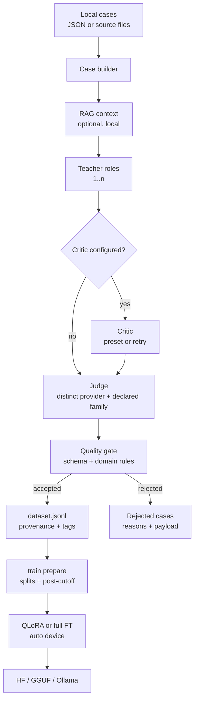

# BrainForge


[](https://github.com/log0u7/brainforge/actions/workflows/ci.yml)
[](https://www.python.org)
[](https://huggingface.co) [](https://platform.openai.com) [](docs/how-to/ship-to-ollama.md)
[](LICENSE)

**Status:** [1.0.0](https://github.com/log0u7/brainforge/releases/tag/v1.0.0) released. Numbers and the honest reading: [benchmark](docs/explanation/benchmark.md).

## What it is

BrainForge turns domain cases into a gate-checked, provenance-tagged JSONL dataset with a multi-teacher LLM pipeline. It can then fine-tune an open student on that dataset (QLoRA, full fine-tuning, or GRPO) and export it to HF, GGUF, or Ollama.

It is a self-hosted Python package and CLI. Datasets, the RAG index, cache, and usage logs stay local. Prompts and retrieved context go to configured providers.

**Use it if** you need auditable provenance, provider-separated adjudication, or a local student model for a domain you control.

**Not for** human-labeled ground truth, a hosted labeling UI, or a guarantee of model-quality gains. **Verified here** means schema-valid, gate-checked, and provenance-complete, not human-reviewed ground truth.

## How it works

1. **Generate.** Cases come from JSON or source files, optionally enriched with local RAG context. One or more teacher roles produce structured analyses.
2. **Challenge (optional and preset-dependent).** A critic can attack the teachers' output before the judge. The ticket standard uses `ticket_teacher`, the `general_teacher` critic, and the judge. Security and coding standards use two teachers and the judge. Maximum modes add the `general_teacher` critic for security and coding, and ticket maximum also adds `ticket_teacher_2`. `retry_with_critic` runs a critic only after the first pass is rejected.
3. **Adjudicate and gate.** The judge runs last. With the default `enforced` setting, it must use a different provider from every non-judge role, plus a different declared model family when both sides declare one. Domain gates check schema, evidence, format, confidence, and optional recitation risk; unresolved verdicts are rejected by default (`reject_unresolved`). Accepted records get provenance; rejected cases are quarantined with reasons.
4. **Train.** Prepare source-grouped splits, fine-tune with QLoRA or full FT on the best detected device (CUDA/ROCm, Intel XPU, Apple MPS, or CPU), run GRPO reinforcement learning against verifiable rewards, and export merged HF weights, GGUF, or an Ollama model.

Dataset-only users can stop after stage 3: the JSONL is the product, and training is optional.

## Quickstart: no keys, no GPU

Requirements: Python 3.12+, [uv](https://docs.astral.sh/uv/), and Git. `mise` is optional.

```bash
git clone https://github.com/log0u7/brainforge.git
cd brainforge
uv sync
uv run brainforge config validate
```

Expected: `configuration is valid`.

Run one ticket case through the full generation and judge path with the deterministic mock provider:

```bash
uv run brainforge pipeline run ticket_triage \
  --input examples/cases/ticket-password-reset-001.json \
  --provider mock --no-rag \
  --output datasets/ticket_triage.jsonl
```

```text
ticket_triage: 1 accepted, 0 rejected (1 cases) -> datasets/ticket_triage.jsonl
```

Inspect the dataset:

```bash
uv run brainforge dataset inspect datasets/ticket_triage.jsonl
```

```text
      Dataset: datasets/ticket_triage.jsonl
┏━━━━━━━━━━━━━━━━━━━━━━━━━━━━━━━━━━━┳━━━━━━━━━━━━┓
┃ Metric                            ┃ Value      ┃
┡━━━━━━━━━━━━━━━━━━━━━━━━━━━━━━━━━━━╇━━━━━━━━━━━━┩
│ records                           │ 1          │
│ recitation_risk                   │ 1 (100.0%) │
│ post-cutoff (primary eval signal) │ 0 (0.0%)   │
│ duplicates                        │ 0          │
└───────────────────────────────────┴────────────┘
```

The mock provider exercises the plumbing, not the labels: it fills role schemas deterministically. `general_teacher` has no cutoff, so the record is tagged `recitation_risk`; the post-cutoff split is empty, so this run says nothing about generalization. The CLI calls the post-cutoff count the primary eval signal; it is a holdout split, not a published benchmark.

Export training splits:

```bash
uv run brainforge train prepare datasets/ticket_triage.jsonl \
  --output datasets/prepared-ticket
```

```text
prepared dataset -> datasets/prepared-ticket
  train: 1
  validation: 0
  test: 0
  test_postcutoff: 0
  warning: only 0 post-cutoff evaluation cases available (minimum recommended:
20); add more recent sources
```

`test_postcutoff.jsonl` can be empty, and the split warns below 20 post-cutoff
cases. This section stops before training: no CUDA and no model weights are
required.

### Train on your hardware

Training, task evaluation, and merged or GGUF export require the training
extra. The device resolves automatically: CUDA/ROCm first, then Intel XPU,
Apple MPS, then CPU (4-bit quantization is CUDA/ROCm only). Run the preflight
before a real run; it never downloads model weights:

```bash
uv sync --extra training
uv run brainforge train check
```

The shipped ticket standard uses an OpenRouter teacher, an MLGW general critic,
and a Zen judge. Configure all three, or pin `steps` to `ticket_teacher` and
`judge` to skip the critic; see
[configure providers](docs/how-to/configure-providers.md).

Create `data/raw` and put real cases there, then run:

```bash
uv run brainforge quickstart run --domain ticket_triage --input data/raw
```

`quickstart` chains pipeline, prepare, training, and best-effort evaluation. It
skips evaluation when the post-cutoff holdout is empty. A mock run still
produces mock labels, so use real providers for a useful student.

For the step-by-step version, see the [tutorial](docs/tutorials/first-model.md)
and [training reference](docs/reference/training.md).

## What you get

| Capability | Detail |
|---|---|
| Providers and cost control | OpenRouter, OpenCode Zen (`chat_completions` only), MLGW, an OpenAI-compatible `chat_completions` endpoint, and a deterministic mock. Env-expanded keys, retries, SQLite response cache, and usage logs with cost estimates when pricing is configured. |
| Multi-teacher ensemble | One or more teacher roles, an optional critic, and a separate judge. Presets for cheap, standard, and maximum modes; `retry_with_critic` adds criticism and a second judge pass after a rejection. |
| Dataset contract | JSONL messages plus source, source date, teachers, judge, gate result, recitation risk and reason, RAG chunks, and agreement where the domain schema supports it. |
| Gates and dataset tooling | Per-domain rules, rejected-case quarantine with reasons, validation, duplicate and contamination inspection, source-grouped splits, and a post-cutoff holdout. Long runs self-trace progress to a state file, readable live with `brainforge pipeline status`. |
| Local RAG | fastembed ONNX embeddings on CPU (or hashing embeddings), SQLite plus NumPy store, chunk provenance, and `--no-rag` to bypass it. |
| Training and export | QLoRA with 4-bit weights and LoRA, full fine-tuning, TRL or opt-in Unsloth, GRPO reinforcement learning with a pluggable verifiable-reward registry, portable device selection (CUDA/ROCm, XPU, MPS, CPU) with preflight checks, resume support, merged HF weights, GGUF, and Ollama. |
| Domain packs | Security and coding reference packs; ticket, CTF, review, audit, and agentic examples; generic fallback for prototypes. |

Knowledge distillation (`--kd`) and abliteration are experimental: documented,
but not benchmarked.

## Why a multi-teacher pipeline

| Question | Single teacher | BrainForge |
|---|---|---|
| What catches a bad answer? | Your evaluation only | A second teacher, a judge review, and the quality gate |
| What about shared blind spots? | No structural check | The judge must differ by provider, plus declared family when set |
| How do you show gains are real? | Your own eval set | Source-grouped splits and a post-cutoff holdout when dates and cutoffs are declared |
| What does it cost? | One call per case, one key | Multiple calls per case, more latency and keys; the cache helps reruns |
| When is it overkill? | Prototypes, low-stakes labels, no eval set | Same; use cheap mode or a single teacher |

This table describes mechanics, not measured accuracy. Evaluate on your own
holdout.

## Architecture



The judge always runs last; the engine enforces that order. RAG is generation
context only, recorded in provenance and never copied into student messages.
Datasets, the RAG index, cache, and logs are local; prompts and retrieved
context go to configured providers.

## How verification works

| Mechanism | What is enforced |
|---|---|
| Structured output | JSON Schema in the prompt, Pydantic validation, and two parse retries |
| Judge separation | At config load, with `enforced`: a different provider from every non-judge role, and a different declared family when both sides set one. `warn` and `off` relax this. |
| Quality gate | Per-domain evidence, format, and confidence rules; unresolved verdicts rejected by default (`reject_unresolved`), except that a teacher/judge dispute on a case with a known ground-truth flag is arbitrated by that flag; optional recitation-risk rejection and abstention fallback |
| Contamination | Source date plus every teacher and critic cutoff produce `recitation_risk` and a reason. Post-cutoff cases form the holdout split, which warns below 20 cases. |
| Provenance | Source, teachers, judge, gate result, RAG chunks, dates, and agreement where supported |
| Dataset validation | Re-checks schema, roles, assistant JSON, and the quality gate |

## Status and known limits

| Area | Status |
|---|---|
| Maturity and evidence | 1.0.0: the end-to-end pipeline works and the training gains are measured. Numbers and the honest reading: [benchmark](docs/explanation/benchmark.md). Pin a commit and measure your own holdout. |
| Mock mode | Deterministic schema filler for plumbing and tests. |
| Training | QLoRA, full FT, KD and task evaluation need the training extra; run `brainforge train check` first. Details: [training reference](docs/reference/training.md). |
| Judge separation | Enforced with providers and declared families; `warn` or `off` defeat it. |
| Contamination | Source dates and teacher cutoffs produce `recitation_risk`; the post-cutoff split is a split, not a benchmark. |
| Dedup and RAG | Inspection-only duplicate detection; NumPy RAG without an ANN index. |
| Experimental | KD and abliteration are not benchmarked. |
| Provider and export edges | `chat_completions` only for Zen; GGUF export needs a local `llama.cpp` checkout (`LLAMA_CPP_DIR`). |

## Providers

| Type | Use and note |
|---|---|
| `openrouter` | Hosted models through OpenRouter model IDs |
| `zen` | OpenCode Zen; `chat_completions` only; `responses` and `anthropic` fail at build |
| `mlgw` | Local OpenAI-compatible gateway; default `http://localhost:8080/v1` |
| `openai` / `local` | Any OpenAI-compatible `chat_completions` endpoint, including Ollama on `http://localhost:11434/v1` |
| `mock` | Deterministic, no network; tests and dry runs |

## Documentation

Start at [docs/index.md](docs/index.md) for the full map.

| Section | Content |
|---|---|
| [Tutorial](docs/tutorials/first-model.md) | Prepare a dataset without keys or a GPU, then train on any device |
| [Providers](docs/how-to/configure-providers.md) | OpenRouter, Zen, MLGW, and local endpoints |
| [Dataset generation](docs/how-to/generate-dataset.md) | Cases, teachers, critic, judge, and gates |
| [Domain packs](docs/how-to/add-domain-pack.md) | Add a domain with its own schemas and rules |
| [Training](docs/reference/training.md) | QLoRA, full FT, evaluation, export |
| [Hardware](docs/reference/hardware.md) | Device support matrix and preflight |
| [CLI](docs/reference/cli.md) and [config](docs/reference/configuration.md) | Commands, flags, and configuration |
| [Dataset format](docs/reference/dataset-format.md) and [quality gates](docs/reference/quality-gates.md) | Record fields, splits, quality gates |
| [Architecture](docs/explanation/architecture.md) | How the pipeline fits together |
| [Method references](docs/explanation/references.md) | The paper behind each training method, anchored to the code |
| [Decision records](docs/adr/index.md) | What was chosen, what was rejected |

## Development, security, license

See [CONTRIBUTING.md](CONTRIBUTING.md) for setup, gitflow, and the full CI gate.

```bash
make test
make lint && make mypy
make ci
```

`make ci` adds the secret scan, config validation, build, and dependency audit.
Integration tests are opt-in: `BRAINFORCE_IT=1 uv run pytest -m integration`.
Mutation testing is `make mutate`.

Report security issues privately as described in [SECURITY.md](SECURITY.md).
BrainForge is [Apache-2.0](LICENSE) licensed.
